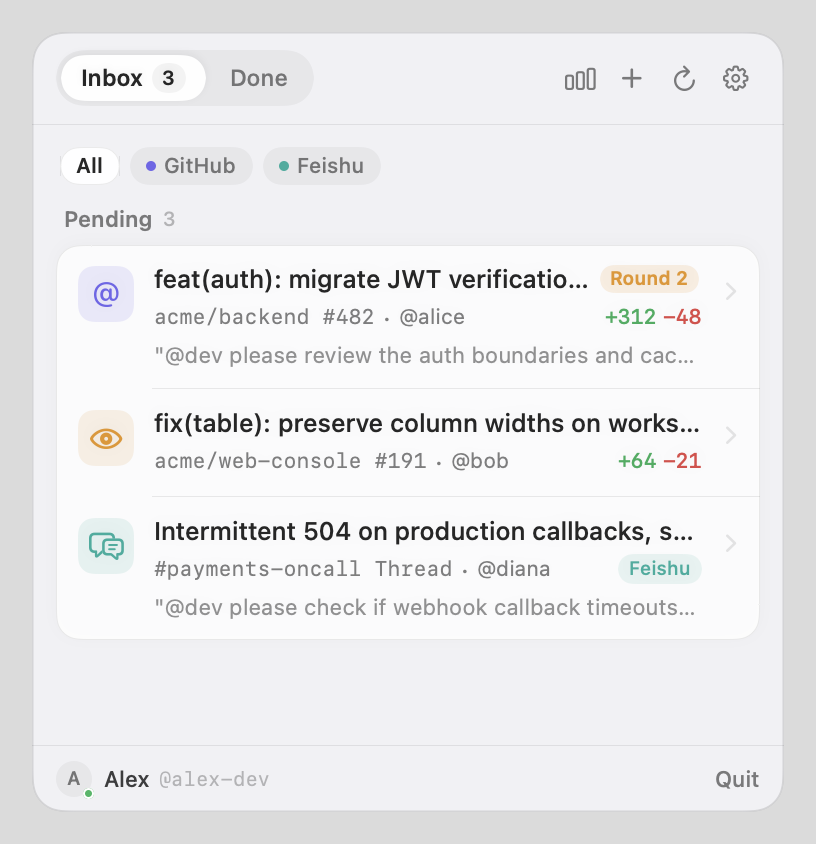
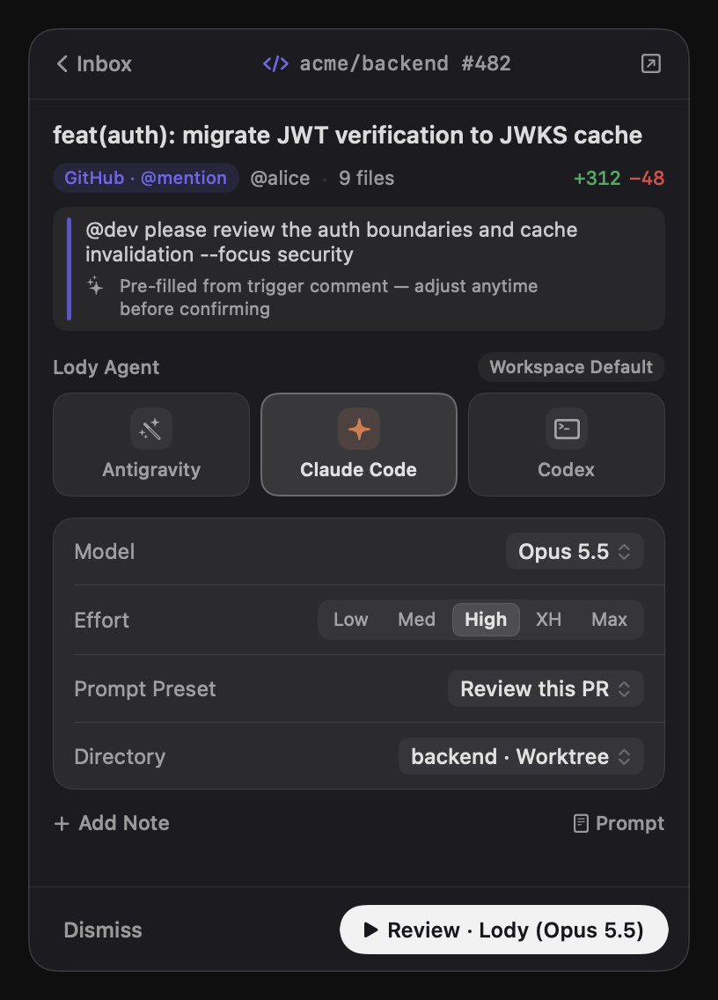
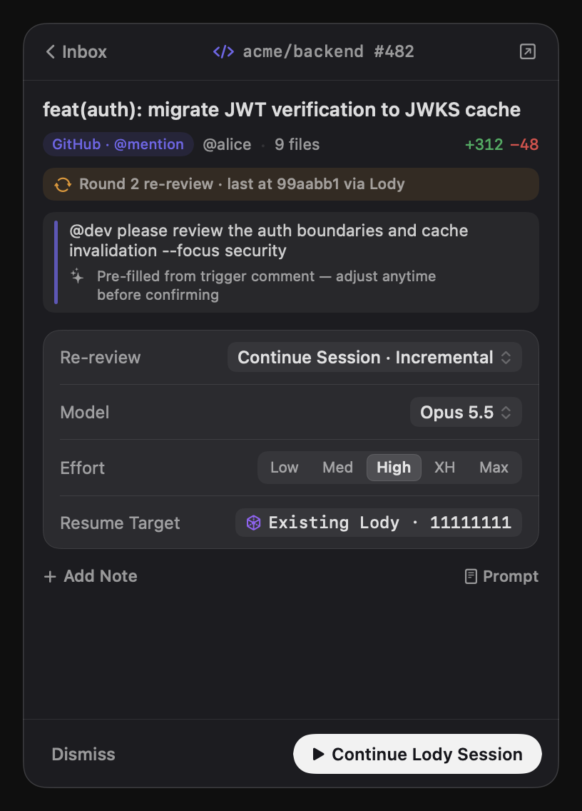
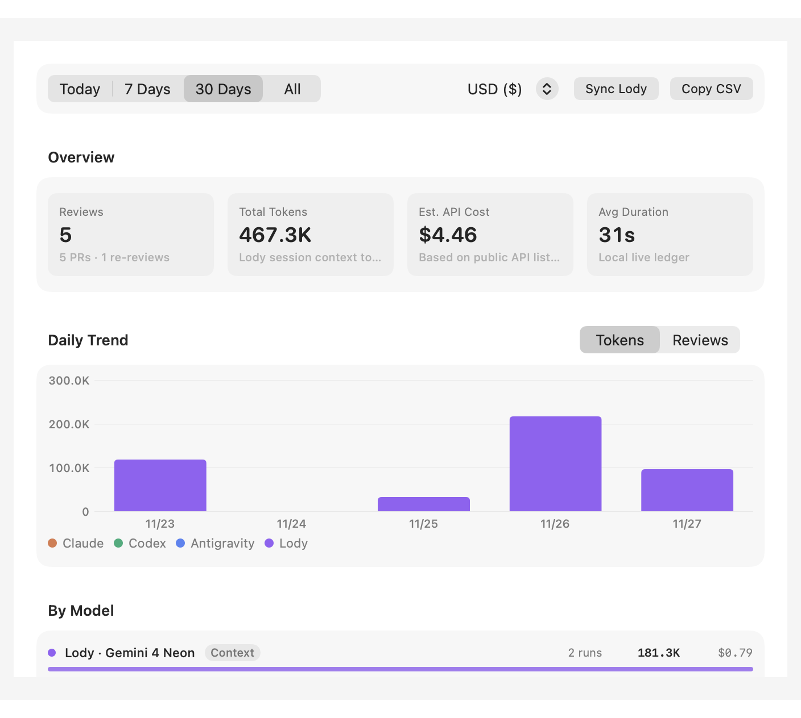
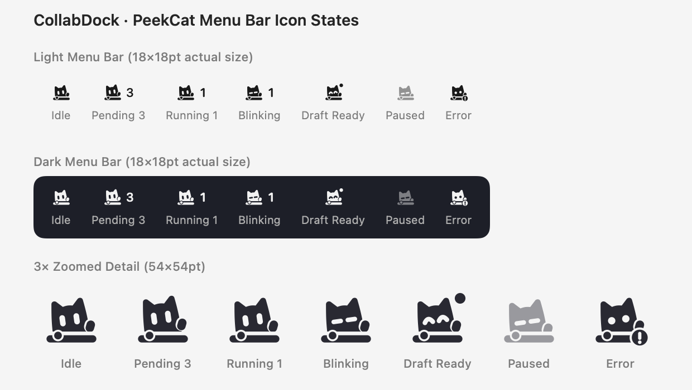

# CollabDock

[](https://github.com/boris-w/collabdock/actions/workflows/ci.yml)
[](LICENSE)
[](#requirements)
[](https://www.swift.org)

[简体中文](README.md) | English

A macOS menu bar app that collects the GitHub PRs waiting for your review into one inbox. After you confirm, it dispatches a background review session through [Lody](https://lody.ai) (choosing an agent such as Claude Code, Codex, or Antigravity and its model) in an isolated git worktree, and tracks live status and context usage.

<p align="center">
  
  
</p>
<p align="center">
  
  
</p>
<p align="center">
  
</p>

## Features

- **GitHub inbox**: polls `/notifications` with `If-Modified-Since` (304 responses don't count against the rate limit). Falls back to the Search API if the token lacks the `notifications` scope (reconciling every 180 s, plus auto-sync when opening the popover after 60 s). You can also click `+` and paste a PR URL or `owner/repo#123`.
- **Trigger rules**: separate toggles for `@mentions` in PR comments (optionally requiring a keyword such as `review` or `cr`, with keyword bypass when you are already a reviewer), review requests, and team requests; repository allow/deny lists with `owner/*` wildcards; ignore draft PRs and bots.
- **Human confirmation before every run**: pick your Lody agent (Claude Code, Codex, Antigravity, …), model, reasoning effort, prompt preset, and project directory on the confirmation card, then click confirm. Nothing starts before that. The full prompt can be previewed.
- **Lody orchestration**: uses the local `lody` CLI (automatically falling back to `npx -y lody@latest`) to sync workspaces, agents, models, local projects, and linked GitHub repositories. Tracks background session progress and jumps straight to Lody Desktop via `lody://` deep links.
- **Isolated worktrees**: routes to your Lody local project (using Lody's native `--worktree --branch`), a cloud-linked repository, or a local isolated git worktree so your active branch and uncommitted changes stay untouched.
- **Incremental re-review**: when a PR gets new commits and you're asked to review again, the previous card is archived as "Moved to Round N" and the new card defaults to continuing the existing Lody session (`lody session chat`) focused on the new commits. You can also start a fresh incremental or full review; rebases and force-pushes fall back to the full range.
- **Auto-archive**: once you approve on GitHub, or the PR is merged or closed, the item moves to "Done". PRs where you requested changes stay in the inbox marked "Awaiting Fix".
- **Usage stats**: local SQLite ledger tracks per-round Lody context usage (counting only incremental context added on continued rounds), duration, and estimated API cost, grouped by day, model, and repository; CSV export; USD or CNY.
- **English & Simplified Chinese UI**: follows macOS system language (falling back to English) or can be switched in Settings → Workspace.
- **Also**: native notifications, launch at login, pause, team config import/export (JSON).

## How it works

```text
GitHub notifications / review requests
  → trigger rules + SQLite de-duplication
  → menu bar inbox
  → you pick a Lody agent, model, and directory and confirm
  → refresh local refs / prepare isolated worktree → dispatch background Lody session
  → track live status & context usage → open in Lody Desktop to read and continue
```

CollabDock keeps GitHub access read-only and never posts reviews or comments itself; the review and any follow-ups live inside your Lody session.

## Security model

PR titles, comments, and commit messages are attacker-controllable input. CollabDock applies several layers:

1. **Human gate**: nothing runs automatically. A Lody session starts only after you click confirm.
2. **Read-only mode by default**: when the selected Lody agent advertises a read-only / plan mode (`plan`, `read-only`), CollabDock passes it automatically.
3. **Untrusted input wrapping**: external content is wrapped in `<untrusted_external_data>` tags (with forged closing tags neutralized), and git commands in follow-up prompts only use integer PR numbers and validated hex SHAs — never untrusted branch names. This reduces prompt and command injection risk; it does not replace human judgment.
4. **Token & host-session isolation**: the GitHub token comes from `gh auth token` and is only used inside the app process for read-only GitHub API calls. `GITHUB_TOKEN`, `GH_TOKEN`, `GH_ENTERPRISE_TOKEN`, `ELECTRON_RUN_AS_NODE`, and `LODY_*` variables are stripped before spawning `lody`, and `lody` starts in a neutral temporary directory so a repository's `package.json` cannot hijack `npx`.
5. **No GitHub writes**: CollabDock itself does not issue any write requests to GitHub.

Limits: the agent inside your Lody session still runs as your macOS user, with permissions and network access governed by that agent's configuration. CollabDock has no server and no telemetry; it only talks to the GitHub API and the local Lody CLI.

To report a vulnerability, see [SECURITY.md](SECURITY.md).

## Requirements

- macOS 14 (Sonoma) or later
- To build from source: Xcode 16 or later (Swift 6 toolchain)
- [GitHub CLI](https://cli.github.com), logged in: `gh auth login`
  - Recommended: add the `notifications` scope with `gh auth refresh -s notifications` (without it, CollabDock falls back to the Search API with a 180 s interval)
- [Lody](https://lody.ai) CLI logged in (global `lody` or working `npx`; run `npx -y lody@latest login`)
- `git`

## Install

There are no prebuilt releases yet. Build from source:

```bash
git clone https://github.com/boris-w/collabdock.git
cd collabdock
make app        # builds build/CollabDock.app (ad-hoc signed)
make run        # build and launch
```

Drag `build/CollabDock.app` to `/Applications`. `make dmg` additionally produces `build/CollabDock-<version>.dmg` and prints its SHA256.

**Gatekeeper**: the app is not notarized. An app you built yourself usually opens directly. If you got a DMG or zip from somewhere else, macOS will block the first launch. Either:

- right-click the app in Finder → Open (on macOS 15 and later, go to System Settings → Privacy & Security and click "Open Anyway"), or
- run `xattr -dr com.apple.quarantine /Applications/CollabDock.app`

`packaging/homebrew/Casks/collabdock.rb` is a Homebrew cask template only; it is not published to any tap yet.

## Quick start

1. After launch, the CollabDock icon appears in the menu bar. Open Settings:
   - **Sources**: check that `gh` is logged in with the right account
   - **Lody**: choose your workspace, default Lody agent (e.g. Claude Code, Codex, Antigravity), model, and reasoning effort
   - **Workspace**: set interface language and directories to search for local clones (default `~/work`, `~/projects`), or bind `owner/repo` to a directory manually
   - **Rules**: adjust keywords and repository scope
2. When someone `@mentions` you in a PR comment (with a keyword) or requests your review, the PR shows up in the inbox with a notification. You can also import a PR with `+`.
3. Open the item, choose the Lody agent, model, effort, and directory (an isolated worktree is the default), and confirm.
4. Once dispatched, CollabDock tracks the session's live status and context usage; click "Open Lody" anytime to view the review and continue in Lody Desktop.

## Development

```bash
make build      # swift build (debug)
make test       # all tests
make test-unit  # unit tests only
make test-e2e   # end-to-end pipeline tests: fake GitHub HTTP + fake lody CLI + real temp git repo; no network or AI needed
make coverage   # all tests + CollabDockCore line-coverage gate (used by CI)
make run        # package the .app and relaunch
```

Debug builds include two developer entry points (not compiled into release builds):

```bash
# Render offscreen light/dark snapshots of the UI in both Chinese and English
swift run CollabDock --snapshot-dir /tmp/collabdock-snapshots

# Run the full Lody dispatch pipeline against a real PR (really calls the local Lody CLI)
swift run CollabDock --e2e-pr owner/repo#123 --agent claude --model opus
```

See [CONTRIBUTING.md](CONTRIBUTING.md) before opening a pull request.

## Project layout

```text
Sources/CollabDockCore/   Pure Swift library, no SwiftUI: read-only GitHub connector, rule engine,
                          Lody command building and output parsing, worktrees, SQLite storage, usage stats
Sources/CollabDockApp/    SwiftUI menu bar app: views, design system, system integration, DEBUG tools
Tests/CollabDockCoreTests/ Core unit tests
Tests/CollabDockAppTests/  App coordinator tests
Tests/CollabDockE2ETests/  End-to-end pipeline tests (fake GitHub HTTP + fake lody CLI + temp git repo)
scripts/                  Build .app / .dmg, generate the icon
packaging/homebrew/       Homebrew cask template
pm/                       Design docs (Chinese): PRD, architecture, ADRs, iteration log, changelog
```

Requirements (`REQ-xxx`), architecture decisions (`ADR-001` to `ADR-007`) and per-iteration notes live in [`pm/`](pm/README.md).

## Roadmap

- A second connector (e.g. GitLab merge requests, Feishu chats/docs). The core already abstracts `CollaborationSource`, with GitHub implemented first.
- Additional execution backends and CLI plugins under a redesigned architecture.
- Signed and notarized releases, a Homebrew tap, and auto-update.

## Notes

- The interface supports both English and Simplified Chinese (with English as the fallback language).
- This project is not affiliated with, endorsed by, or sponsored by Anthropic, OpenAI, Google, or Lody. Product names and trademarks belong to their respective owners.
- Costs and data handling of Lody and each AI agent are governed by that provider's terms.

## License

[MIT](LICENSE)
