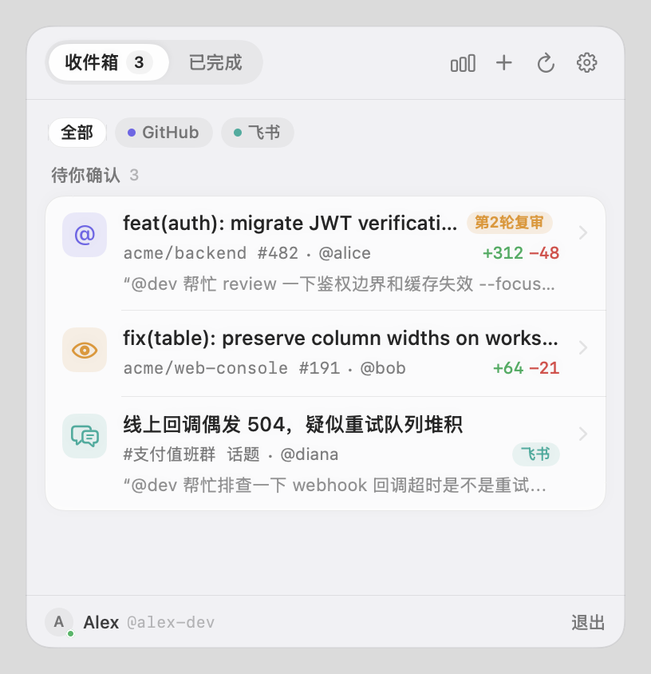
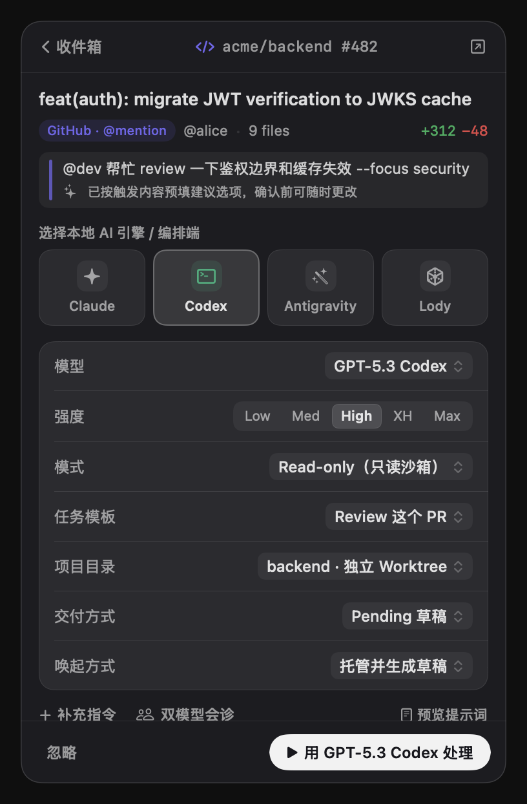
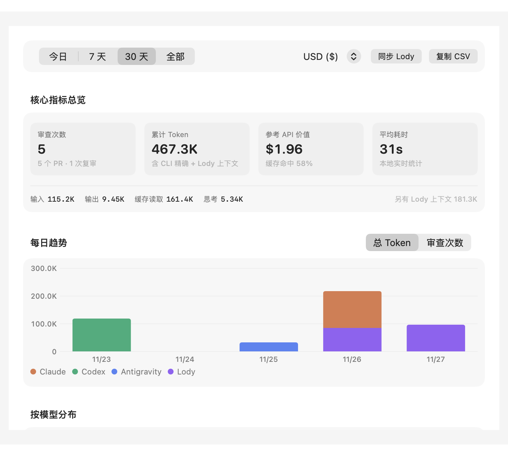

# CollabDock

[](https://github.com/boris-w/collabdock/actions/workflows/ci.yml)
[](LICENSE)
[](#环境要求)
[](https://www.swift.org)

简体中文 | [English](README.en.md)

macOS 菜单栏应用：把 GitHub 上找你 Review 的 PR 收进一个收件箱，经你确认后，用本机的 AI CLI（Claude Code / Codex / Antigravity / Lody）在只读的隔离 worktree 里审查，结果写回为只有你自己可见的 GitHub Pending Review 草稿。

<p align="center">
  
  
</p>
<p align="center">
  
  
</p>
<p align="center">
  
</p>

## 功能

- **GitHub 收件箱**：轮询 `/notifications`（`If-Modified-Since` 条件请求，304 不计配额）；token 缺 `notifications` scope 时自动降级为 Search API。也可以点 `+` 直接粘贴 PR 链接或 `owner/repo#123`。
- **触发规则**：分别开关 `@我` 评论（可要求包含关键词，如 `review`、`cr`、`帮忙看`）、Request Review、团队指派；支持仓库白/黑名单（`owner/*` 通配）、忽略 Draft PR 和 Bot。
- **执行前人工确认**：每个任务都要你选好引擎、模型、思考强度、模式、项目目录和交付方式，点「确认执行」后才会启动 CLI。可以先预览完整提示词。
- **四种本地引擎**：`claude`、`codex`、`agy`、`lody`（找不到时回退到 `npx lody`）。模型列表尽量从 CLI 实时获取（如 `agy models`、`lody agent-config list`）。
- **隔离 worktree**：按 `owner/repo` 自动匹配本地仓库（找不到则浅克隆到缓存目录），用 `git worktree add --detach` 检出 PR head，不动你当前的分支和未提交修改。
- **Pending Review 草稿**：行内评论先按 diff hunk 校验行号，越界的并入总结，避免 GitHub 返回 422；代码建议转成 ```` ```suggestion ```` 块。也可以选择只生成本地 Markdown 报告，或直接发表评论。
- **增量复审**：PR 有新提交后再次请求 Review，会标为「第 N 轮复审」，可以选择续聊原会话只看增量 diff、新开会话看增量 diff，或重新全量审查；检测到 rebase / force-push 时回退为全量。
- **双模型会诊**：同一 PR 并行跑两个引擎/模型，标出双方都指出的问题（共识）与各自的独立发现。
- **自动归档**：你在 GitHub 上 Approve，或 PR 被合并/关闭后，条目自动移到「已完成」；Request Changes 的 PR 留在收件箱。
- **用量统计**：本地记录每次运行的 token（输入/输出/缓存/思考）、耗时和估算成本，按天、模型、仓库汇总，可导出 CSV，币种可选 USD / CNY。
- **会话接管**：一键在终端打开对应会话（`claude --resume`、`codex resume`、`agy --resume`），或通过 `lody://` 链接跳到 Lody Desktop。
- **双语界面与独立审查语言**：界面支持简体中文与英文（默认跟随系统，无匹配时回退英文），可在「设置 → 工作区」手动切换；写回 GitHub 的审查标题、严重度、本地报告与会诊汇总文案支持单独设置「审查语言」。
- **其他**：macOS 原生通知、开机自启、暂停监听、团队配置包（JSON）导入导出。

## 工作原理

```text
GitHub 通知 / 待审 PR
  → 触发规则过滤、SQLite 去重
  → 菜单栏收件箱
  → 你在确认卡片里选好参数并点击执行
  → 隔离 git worktree + 以只读模式运行本地 AI CLI（输出受 JSON Schema 约束）
  → 校验行号 → GitHub Pending Review 草稿 / 本地 Markdown 报告
  → 你在 GitHub 上修改、提交（或丢弃）草稿
```

使用 Lody 时，任务会派发为一个 Lody 后台会话。审查结论在 Lody 里查看和继续对话；CollabDock 负责跟踪会话状态和用量，不会把结果写回 GitHub。

## 安全模型

PR 标题、评论和 diff 都是外部可控的输入。CollabDock 的防护分为几层：

1. **人工门控**：不会自动执行任何东西。只有你在确认卡片上点击「确认执行」，才会启动 AI 子进程。
2. **默认只读**：
   - Claude Code：`--permission-mode plan`，`--allowedTools` 只放行 `Read,Grep,Glob` 和 `git diff/log/show`
   - Codex：`codex exec --sandbox read-only`
   - Antigravity：`agy --mode plan --sandbox`
   - Lody：使用所选 Agent 的只读 / plan 模式（如果该 Agent 提供）

   模式可以在设置或确认卡片里改成可写模式（如 Codex `workspace-write`、Claude `acceptEdits`）。改了之后，上面的只读保证就不再成立。
3. **不可信输入隔离**：外部内容在提示词里包在 `<untrusted_external_data>` / `<untrusted_pr_diff>` 标签中，并明确要求模型不得把其中的文字当作指令。这只能降低提示词注入的风险，不能根除。
4. **GitHub token 不交给 AI 子进程**：token 由 `gh auth token` 获取，只在应用进程内用于调用 GitHub API。启动 AI 子进程前会从环境变量中移除 `GITHUB_TOKEN`、`GH_TOKEN`、`GH_ENTERPRISE_TOKEN`。所有写 GitHub 的操作都由应用自身在校验结构化输出后完成。
5. **默认只写草稿**：默认的交付方式是不带 `event` 的 Pending Review，提交之前只有你自己能看到。

需要说明的边界：AI CLI 仍然以你的系统用户身份运行。如果把它切到可写或可执行任意 shell 的模式，它就有可能读到你本机的其他凭据（例如 `gh` 自己保存的登录信息）。CollabDock 本身没有服务端，也没有遥测，只访问 GitHub API；AI CLI 自身的网络访问由各 CLI 决定。

发现安全问题请看 [SECURITY.md](SECURITY.md)。

## 环境要求

- macOS 14 (Sonoma) 及以上
- 从源码构建：Xcode 16 或更高版本（Swift 6 工具链）
- [GitHub CLI](https://cli.github.com) 已登录：`gh auth login`
  - 建议补充 `notifications` 权限：`gh auth refresh -s notifications`（没有的话会降级为 Search API，轮询间隔 180 秒）
- 至少安装并登录以下一种 CLI：`claude`（Claude Code）、`codex`（OpenAI Codex CLI）、`agy`（Google Antigravity CLI）、`lody`（或可用的 `npx`）
- `git`

## 安装

目前还没有发布预编译版本，需要从源码构建：

```bash
git clone https://github.com/boris-w/collabdock.git
cd collabdock
make app        # 生成 build/CollabDock.app（ad-hoc 签名）
make run        # 构建并启动
```

把 `build/CollabDock.app` 拖到 `/Applications` 即可。`make dmg` 会额外生成 `build/CollabDock-<版本>.dmg`，并打印 SHA256。

**关于 Gatekeeper**：应用没有经过 Apple 公证。自己本地构建的 app 一般可以直接打开；如果是从别处下载的 DMG / zip，首次打开会被拦截，可以：

- 在 Finder 中右键 → 打开（macOS 15 及以上需到「系统设置 → 隐私与安全性」点击「仍要打开」），或
- 执行 `xattr -dr com.apple.quarantine /Applications/CollabDock.app`

`packaging/homebrew/Casks/collabdock.rb` 只是 Homebrew Cask 模板，尚未发布到任何 tap。

## 快速上手

1. 启动后，菜单栏会出现 CollabDock 图标。打开「设置」：
   - **协作来源**：确认 `gh` 已登录、显示的账号正确
   - **工作区**：设置本地代码搜索目录（默认 `~/work`、`~/projects`），或手动把 `owner/repo` 绑定到某个目录
   - **AI 引擎**：选择默认引擎、模型、思考强度和模式
   - **触发规则**：按需调整关键词和仓库范围
2. 有人在 PR 评论里 `@你`（且包含关键词）或给你 Request Review 时，PR 会出现在收件箱，同时弹出系统通知。也可以点 `+` 手动导入一个 PR。
3. 点开条目，在确认卡片里检查参数（项目目录默认使用独立 worktree，交付方式默认是 Pending 草稿），然后点「确认执行」。
4. 完成后，点击打开 GitHub 的 Files 页面查看草稿，修改后由你自己提交；也可以打开本地报告，或在终端里接管会话继续追问。

## 开发

```bash
make build      # swift build（Debug）
make test       # 运行全部测试
make test-unit  # 只跑单元测试
make test-e2e   # 端到端管线测试：假 GitHub HTTP + 假 agent CLI + 真实临时 git 仓库，不需要网络和 AI
make coverage   # 全部测试 + CollabDockCore 行覆盖率门槛（CI 使用）
make run        # 打包 .app 并重启
```

DEBUG 构建自带两个调试入口（不会编进 Release 包）：

```bash
# 离屏渲染各个界面的 Light/Dark 截图，用于视觉回归
swift run CollabDock --snapshot-dir /tmp/collabdock-snapshots

# 对一个真实 PR 跑完整链路（会真的调用本地 AI CLI；默认只生成本地报告）
swift run CollabDock --e2e-pr owner/repo#123 --engine claude   # 可选：claude | codex | agy | lody
```

`--e2e-pr` 还支持 `--model <id>` 和 `--delivery <localDraftOnly|platformDraft|directReply>`。

参与贡献请先阅读 [CONTRIBUTING.md](CONTRIBUTING.md)。

## 项目结构

```text
Sources/CollabDockCore/   纯 Swift 业务库，不依赖 SwiftUI：GitHub 连接器、规则引擎、
                          CLI 命令构造与流式解析、worktree 管理、SQLite 存储、用量统计
Sources/CollabDockApp/    SwiftUI 菜单栏应用：界面、设计系统、系统集成、DEBUG 调试工具
Tests/CollabDockCoreTests/ 单元测试
Tests/CollabDockE2ETests/  端到端管线测试（假 GitHub HTTP + 假 agent CLI + 临时 git 仓库）
scripts/                  打包 .app / .dmg、生成图标
packaging/homebrew/       Homebrew Cask 模板
pm/                       设计文档：PRD、架构、ADR、迭代记录、变更日志
```

需求（`REQ-xxx`）、架构决策（`ADR-001` ~ `ADR-007`）和每轮迭代的记录都在 [`pm/`](pm/README.md)。

## 路线图

- 第二个协作连接器（如 GitLab MR、飞书群聊/文档）。核心层已经按 `CollaborationSource` / `CollaborationSink` 抽象，但目前只实现了 GitHub。
- Claude Code / Codex / Antigravity 原生插件：在 CLI 会话里浏览和认领同一个任务队列。
- 签名公证的正式发布、Homebrew tap 和自动更新。

## 说明

- 界面与写回 GitHub 的审查文案均支持简体中文与英文（默认跟随系统，无匹配时回退英文）。
- 本项目与 Anthropic、OpenAI、Google、Lody 均无关联，也未获得其认可。各产品名称和商标归各自所有者。
- 使用各 AI CLI 产生的费用和数据处理遵循各自服务条款。

## 许可证

[MIT](LICENSE)
