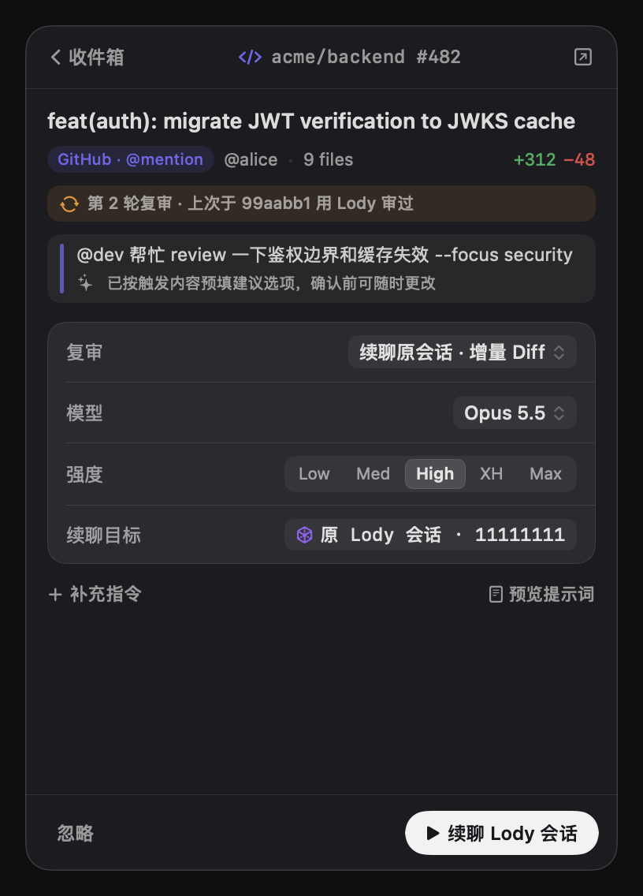
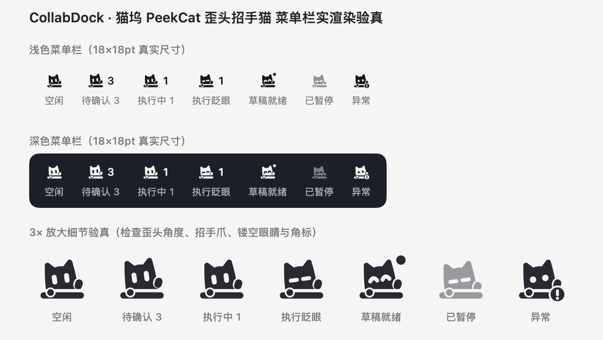

# CollabDock

[](https://github.com/boris-w/collabdock/actions/workflows/ci.yml)
[](LICENSE)
[](#环境要求)
[](https://www.swift.org)

简体中文 | [English](README.en.md)

macOS 菜单栏应用：把 GitHub 上找你 Review 的 PR 收进一个收件箱，经你确认后，通过 [Lody](https://lody.ai)（可选 Claude Code、Codex、Antigravity 等 Agent 与模型）在隔离的 git worktree 中启动后台审查会话，并实时跟踪会话状态与上下文用量。

<p align="center">
  
  
</p>
<p align="center">
  
  
</p>
<p align="center">
  
</p>

## 功能

- **GitHub 收件箱**：轮询 `/notifications`（`If-Modified-Since` 条件请求，304 不计配额）；token 缺 `notifications` scope 时自动降级为 Search API（每 180 秒对齐，打开弹窗距上次对齐超 60 秒自动同步）。也可以点 `+` 直接粘贴 PR 链接或 `owner/repo#123`。
- **触发规则**：分别开关 `@我` 评论（可要求包含关键词，如 `review`、`cr`、`帮忙看`；你已是 reviewer 的 PR 免关键词放行）、Request Review、团队指派；支持仓库白/黑名单（`owner/*` 通配）、忽略 Draft PR 和 Bot。
- **执行前人工确认与可选自动开始**：默认每个任务都在确认卡片上由你选好 Lody Agent（如 Claude Code / Codex / Antigravity）、模型、思考强度、提示词模板和项目目录后再派发，并可预览提示词原文；也支持在「设置 → 触发规则」按触发方式与仓库白名单（`owner/*`）开启「收到请求自动开始审查」（默认关闭），并可在菜单栏底栏一键暂停/恢复，或在详情页停止并换设置重来。
- **开始审查 👀 标记**：Lody 会话派发成功后，默认在触发评论或 PR 上加一个 👀 表情（`eyes` reaction），让作者知道已经在看了（ADR-009：CollabDock 唯一的 GitHub 写操作，可在设置中随时关闭以保持完全只读）。
- **Lody 编排执行**：通过本机 `lody` CLI（未全局安装时自动回退到 `npx -y lody@latest`）实时拉取工作区、Agent、模型、本地项目与已绑定 GitHub 仓库目录，后台派发会话并持续轮询进度，一键通过 `lody://` 链接在 Lody Desktop 中打开或继续追问。
- **隔离 worktree**：自动路由到本地 Lody 项目（使用 Lody 原生 `--worktree --branch` 隔离分支）、云端已绑定仓库或本地自动创建的隔离 worktree，不动你当前的工作分支和未提交修改。
- **增量复审**：PR 有新提交后再次请求 Review，旧卡片自动归档为「已进入第 N 轮」，新卡片标为「第 N 轮复审」，默认续聊上一轮 Lody 会话（`lody session chat`）只看增量改动，也可以新开增量或全量会话；检测到 rebase / force-push 时自动回退为全量范围。
- **自动归档**：你在 GitHub 上 Approve，或 PR 被合并/关闭后，条目自动移到「已完成」；Request Changes 的 PR 留在收件箱并标示「待修复」。
- **用量统计**：本地 SQLite 记录每次审查的 Lody 上下文用量（续聊轮次仅记相对上一轮的新增上下文）、本轮耗时和估算 API 价值，按天、模型、仓库汇总，可导出 CSV，币种可选 USD / CNY。
- **双语界面**：支持简体中文与英文（默认跟随 macOS 系统语言，无匹配时回退英文），可在「设置 → 工作区」手动切换并重启生效。
- **其他**：macOS 原生通知、开机自启、暂停监听、团队配置包（JSON）导入导出。

## 工作原理

```text
GitHub 通知 / 待审 PR
  → 触发规则过滤、SQLite 去重
  → 菜单栏收件箱
  → 你在确认卡片里选择 Lody Agent、模型、目录并确认
  → 刷新本地项目分支引用 / 准备隔离 worktree → 派发 Lody 后台会话
  → 实时跟踪会话状态与上下文用量 → 一键在 Lody Desktop 查看结论并继续对话
```

除开始审查时可选添加 👀 表情（默认开启，可关闭）外，CollabDock 对 GitHub 保持只读，不代发审查评论、草稿或 Approve；审查过程和后续操作都在 Lody 会话中完成。

## 安全模型

PR 标题、评论和提交信息都是外部可控的输入。CollabDock 的防护分为几层：

1. **人工门控（默认）**：默认不会自动执行任何东西，只有你在确认卡片上点击确认才会派发 Lody 会话；如主动开启「自动开始审查」，也只对符合触发方式与仓库白名单的 GitHub PR 生效，且随时可暂停或停止重来。
2. **默认只读模式**：若所选 Lody Agent 提供只读 / plan 模式（如 `plan`、`read-only`），派发时会自动传入该只读模式。
3. **极简提示词边界**：发给 Lody 的消息只包含你配置的模板（首次审查 / PR 更新后复审）及可选补充指令，外部 PR 标题、正文、评论或分支名均不拼入提示词；仅渲染经严格校验的有限占位符（`{{pr_url}}`、`{{repo}}`、`{{number}}`、`{{head_sha}}`、`{{previous_sha}}`），降低提示词与命令注入风险（但不能替代人工审查）。
4. **GitHub token 与宿主会话隔离**：token 由 `gh auth token` 获取，只在应用进程内发往已配置的 GitHub API 主机。启动 `lody` 子进程前会剥离 `GITHUB_TOKEN`、`GH_TOKEN`、`GH_ENTERPRISE_TOKEN` 以及 `ELECTRON_RUN_AS_NODE`、`LODY_*` 宿主环境变量，并在中性临时目录启动，防止目标仓库内同名 `package.json` 劫持 `npx`。
5. **最小化 GitHub 写入**：CollabDock 唯一可能发出的 GitHub 写请求是开始审查时的 👀 表情（默认开启，关掉后完全只读）；评论地址须经严格同源与路径校验才使用，否则一律退回 PR 本身，token 绝不发往其他主机。CollabDock 绝不代发任何评论、Review 草稿或 Approve。

需要说明的边界：Lody 会话中的 Agent 仍以你的系统用户身份运行，其权限与网络访问由对应 Lody Agent 配置决定。CollabDock 本身没有服务端，也没有遥测，只访问 GitHub API 和本机 Lody CLI。

发现安全问题请看 [SECURITY.md](SECURITY.md)。

## 环境要求

- macOS 14 (Sonoma) 及以上
- 从源码构建：Xcode 16 或更高版本（Swift 6 工具链）
- [GitHub CLI](https://cli.github.com) 已登录：`gh auth login`
  - 建议补充 `notifications` 权限：`gh auth refresh -s notifications`（没有的话会降级为 Search API，轮询间隔 180 秒）
- [Lody](https://lody.ai) CLI 已登录（全局 `lody` 或可用的 `npx`，可执行 `npx -y lody@latest login`）
- `git`

## 安装

从 [GitHub Releases](https://github.com/boris-w/collabdock/releases) 下载最新的 `CollabDock-<版本>.dmg`（同时支持 Apple 芯片与 Intel），打开后把 CollabDock 拖到「应用程序」。

也可以从源码构建：

```bash
git clone https://github.com/boris-w/collabdock.git
cd collabdock
make app        # 生成 build/CollabDock.app（ad-hoc 签名）
make run        # 构建并启动
```

把 `build/CollabDock.app` 拖到 `/Applications` 即可。`make dmg` 会额外生成 `build/CollabDock-<版本>.dmg`，并打印 SHA256。

**关于 Gatekeeper**：应用没有经过 Apple 公证。自己本地构建的 app 一般可以直接打开；如果是从别处下载的 DMG / zip，首次打开会被拦截，可以：

- 在 Finder 中右键 → 打开（macOS 15 及以上需到「系统设置 → 隐私与安全性」点击「仍要打开」），或
- 执行 `xattr -dr com.apple.quarantine /Applications/CollabDock.app`

`packaging/homebrew/Casks/collabdock.rb` 只是 Homebrew Cask 模板，尚未发布到任何 tap。

## 快速上手

1. 启动后，菜单栏会出现 CollabDock 图标。打开「设置」：
   - **协作来源**：确认 `gh` 已登录、显示的账号正确
   - **Lody**：选择目标 Workspace、默认 Lody Agent（如 Claude Code / Codex / Antigravity）、默认模型与思考强度
   - **工作区**：设置界面语言与本地代码搜索目录（默认 `~/work`、`~/projects`），或手动把 `owner/repo` 绑定到某个目录
   - **触发规则**：按需调整关键词和仓库范围
2. 有人在 PR 评论里 `@你`（且包含关键词）或给你 Request Review 时，PR 会出现在收件箱，同时弹出系统通知。也可以点 `+` 手动导入一个 PR。
3. 点开条目，在确认卡片里选择 Lody Agent、模型、思考强度与项目目录（默认使用隔离 worktree），点击确认派发。
4. 派发后卡片会实时显示 Lody 审查进度与上下文用量；随时点击「打开 Lody」跳转到 Lody Desktop 查看结论并继续对话。

## 开发

```bash
make build      # swift build（Debug）
make test       # 运行全部测试
make test-unit  # 只跑单元测试
make test-e2e   # 端到端管线测试：假 GitHub HTTP + 假 lody CLI + 真实临时 git 仓库，不需要网络和 AI
make coverage   # 全部测试 + CollabDockCore 行覆盖率门槛（CI 使用）
make run        # 打包 .app 并重启
```

DEBUG 构建自带两个调试入口（不会编进 Release 包）：

```bash
# 离屏渲染中英文界面的 Light/Dark 截图，用于视觉回归
swift run CollabDock --snapshot-dir /tmp/collabdock-snapshots

# 对一个真实 PR 跑完整 Lody 派发链路（会真的调用本机 Lody CLI）
swift run CollabDock --e2e-pr owner/repo#123 --agent claude --model opus
```

参与贡献请先阅读 [CONTRIBUTING.md](CONTRIBUTING.md)。

## 项目结构

```text
Sources/CollabDockCore/   纯 Swift 业务库，不依赖 SwiftUI：GitHub 只读连接器、规则引擎、
                          Lody 命令构造与输出解析、worktree 管理、SQLite 存储、用量统计
Sources/CollabDockApp/    SwiftUI 菜单栏应用：界面、设计系统、系统集成、DEBUG 调试工具
Tests/CollabDockCoreTests/ Core 单元测试
Tests/CollabDockAppTests/  App 协调层测试
Tests/CollabDockE2ETests/  端到端管线测试（假 GitHub HTTP + 假 lody CLI + 临时 git 仓库）
scripts/                  打包 .app / .dmg、生成图标
packaging/homebrew/       Homebrew Cask 模板
pm/                       设计文档：PRD、架构、ADR、迭代记录、变更日志
```

需求（`REQ-xxx`）、架构决策（`ADR-001` ~ `ADR-007`）和每轮迭代的记录都在 [`pm/`](pm/README.md)。

## 路线图

- 更多协作连接器（如 GitLab MR、飞书群聊/文档）。核心层已按 `CollaborationSource` 抽象，目前实现了 GitHub。
- 以新架构重新接入其他执行后端与 CLI 插件。
- 签名公证的正式发布、Homebrew tap 和自动更新。

## 说明

- 界面支持简体中文与英文（默认跟随系统，无匹配时回退英文）。
- 本项目与 Anthropic、OpenAI、Google、Lody 均无关联，也未获得其认可。各产品名称和商标归各自所有者。
- 使用 Lody 及各 AI Agent 产生的费用和数据处理遵循各自服务条款。

## 许可证

[MIT](LICENSE)
