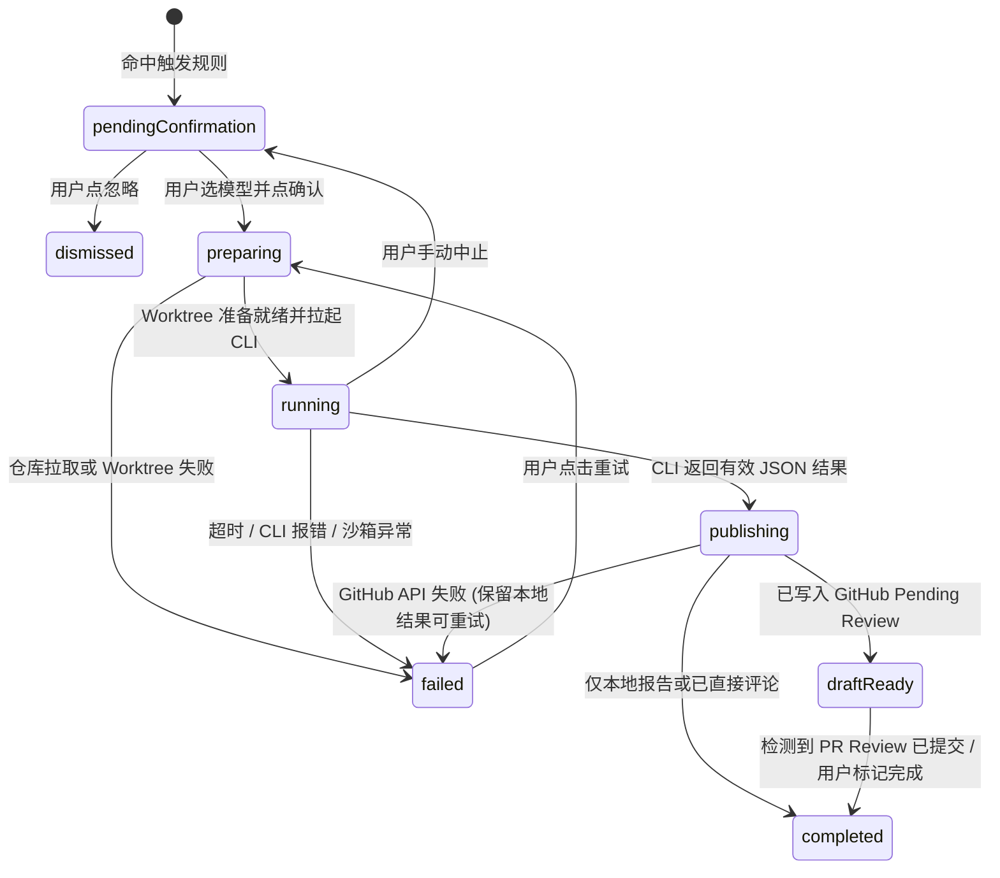

# 02 · 原生 SwiftUI 菜单栏交互与界面规范（UX Spec）

> **2026-11-28 起执行方式只保留 Lody（见 [ADR-008](../03-architecture/decisions/ADR-008-lody-only-execution.md)）。** 文中关于直连 Claude Code / Codex / Antigravity CLI、托管运行、JSON Schema、双模型会诊、GitHub Pending 草稿回写和本地报告的内容已过时，仅作历史参考。

> **关联需求**：[REQ-003](./PRD.md#req-003--可手动配置的触发规则引擎p0) | [REQ-004](./PRD.md#req-004--macos-原生菜单栏常驻与通知提醒p0) | [REQ-005](./PRD.md#req-005--人工确认门控与动态模型选择p0)  
> **设计原则**：对标 **CodexBar × Magpie × Linear × macOS Tahoe Liquid Glass** —— 克制中性灰阶、零系统灰表单堆砌、两级渐进披露（收件箱列表 -> Control Center 推入确认画布）、3 秒完成「扫一眼 PR -> 点进选引擎/模型 -> 确认执行」。

---

## 1. 界面结构总览

ReviewDock 采用 macOS 原生**双表面 + 两级钻取结构**：

1. **菜单栏主浮窗（`MenuBarExtra(.window)`，黄金宽度 `368pt`，列表自适应高度 / 详情 `516pt`）**：
   - **一级 · 收件箱列表**：单张 Grouped Inset Card 列出待确认 PR，底部附本地引擎快速切换条（`Claude` / `Codex` / `Antigravity`）。
   - **二级 · 单 PR 确认画布（平滑推入 Drill-Down）**：三宫格引擎瓷砖 + 单张 Inset 参数卡（自定义无框 Menu + 行内思考强度胶囊）+ 全屏唯一高对比黑白主胶囊按钮。
2. **独立设置窗口（`Settings` Scene，宽 `600pt` × 高 `440pt`）**：5 个原生分组 Tab 管理所有手动配置项与团队模板；打开前显式激活 App 以兼容 macOS 26 Tahoe。

---

## 2. 菜单栏图标状态规范

统一采用专属「**猫坞 PeekCat · 歪头招手猫**」`18×18pt` `@2x` 单色 Template 矢量（`PeekCatMenuBarIcon.swift`），所有状态均保留品牌歪头招手猫轮廓锚点，绝不切回通用系统图标导致失焦：

| 应用状态 | 菜单栏图标与文本 | 说明 |
| :--- | :--- | :--- |
| 空闲（无待确认） | 歪头招手猫 + 竖胶囊眼 | 极简单色 Template 矢量，不显示数字 |
| 有待确认任务 | 猫头微微探高 + 等宽数字（如 `3`） | 醒目提示有协作任务等待确认执行 |
| AI 正在执行中 | 歪头招手猫 + 每 2.5s 轻眨眼 + 数字（如 `1`） | 后台活跃执行反馈，空闲自动停循环零耗电 |
| 草稿已就绪待提交 | 开心弯弯笑眼 `^ ^` + 右上角实心圆点 | 提示可去 GitHub 审阅 Pending Review 或查看报告 |
| 已暂停监听 | 45% 均匀半透明 + `- -` 闭眼打盹 | 直观传达暂停状态且依然认得出是 CollabDock |
| 同步 / 认证异常 | 惊讶圆眼 + 右下角透明护圈 `!` 徽章 | 提醒点开查看认证或网络错误详情 |

---

## 3. 菜单栏浮窗（Popover）布局设计

### 3.1 顶部状态栏（Header）
- 左侧：应用名 `ReviewDock` + 实时同步状态点（如 `已同步 · 28s 前` 或 `已暂停`）。
- 右侧：3 个紧凑图标按钮：`立即刷新`、`暂停/恢复监听`、`打开设置 (⌘,)`。

### 3.2 分段切换（Segmented Control）
- **`待处理 (N)`**：等待确认的任务 + 正在执行中的任务（执行中自动浮顶）。
- **`草稿 / 历史 (M)`**：已生成 GitHub Pending Review 的任务、本地报告及已处理记录。

### 3.3 核心交互：人工确认卡片（Confirmation Card）

点击待处理列表中的任意一条 PR（若只有 1 条则默认展开），显示紧凑且无压迫感的确认表单：

```text
┌────────────────────────────────────────────────────────┐
│ acme/backend #482           [@mention]   +312 / -48    │
│ feat(auth): migrate JWT verification to JWKS cache     │
│ 作者: @alice · 2 分钟前 · 9 files                       │
│ ┌────────────────────────────────────────────────────┐ │
│ │ "@boris 帮忙 review 一下鉴权边界和缓存失效逻辑"        │ │
│ └────────────────────────────────────────────────────┘ │
│                                                        │
│ AI 引擎     [ Claude Code ▾ ]                          │
│ 模型        [ Claude Opus ▾ ]   强度 [ High ▾ ]        │
│ 审查模板    [ 通用代码审查 ▾ ]                          │
│ 输出方式    [ GitHub Pending 草稿 (仅自己可见) ▾ ]      │
│ 补充指令    [ 可选：本次额外关注点...                 ]  │
│                                                        │
│ [ 忽略 ]  [ 打开 PR ]                [ ▶ 确认执行 ]    │
└────────────────────────────────────────────────────────┘
```

### 3.4 运行中卡片（Running Card）
- 展示当前选用的引擎+模型胶囊（如 `Antigravity · Gemini 4 Neon (XHigh)`）、已运行秒数、实时流式状态行（例如 `正在读取 src/middleware/auth.ts...`）以及 `中止` 按钮。

### 3.5 草稿就绪卡片（Draft Ready Card）
- 展示 AI 汇总摘要（Severity 计数：`🔴 1 严重 · 🟡 3 建议 · ⚪ 2 细节`）。
- 三个主动作：
  - **`打开 GitHub 审阅草稿`**（主按钮，直达 PR Files Changed / Review 页面）
  - **`查看本地报告`**（本地 Markdown 预览窗）
  - **`终端继续追问`**（一键在终端 `--resume` 接管会话）

---

## 4. 设置窗口（Settings Scene）5 大 Tab 设计

确保用户的「手动配置」与「团队分发」诉求全部清晰归位：

| Tab | 配置内容 |
| :--- | :--- |
| **1. 通用与 GitHub** | GitHub 认证方式（自动复用 `gh` / 手工 PAT）、当前账号显示、轮询间隔（默认遵循服务端 `X-Poll-Interval`，可设 60s~600s）、开机自启开关、原生通知开关、语言（简体中文 / English） |
| **2. 触发规则** | 独立开关：`PR @我评论`、`Request Review 指派`、`Team 指派`；`@我` 关键词白名单开关与标签编辑；仓库白名单/黑名单（支持 `org/*`）；忽略 Draft PR / 忽略 Bot；解析评论内 `--model` 建议开关 |
| **3. AI 引擎与模型** | 三个引擎的健康检测状态与自定义路径；每个引擎的默认模型与思考强度；一键刷新 `agy models`；自定义模型别名列表；按 PR 行数自动推荐模型的规则 |
| **4. 仓库与工作区** | 本地代码扫描目录列表（如 `~/work`）；自动识别到的仓库映射表与手动覆写；缓存/Worktree 存放路径与自动清理策略（完成后保留 24h / 立即清理） |
| **5. 团队与模板** | Review Prompt 预设模板编辑器；默认交付模式（Pending Draft / 本地 / Comment）；**一键导出团队配置包 / 导入团队配置包**；检查更新（Sparkle） |

---

## 5. 任务状态机


