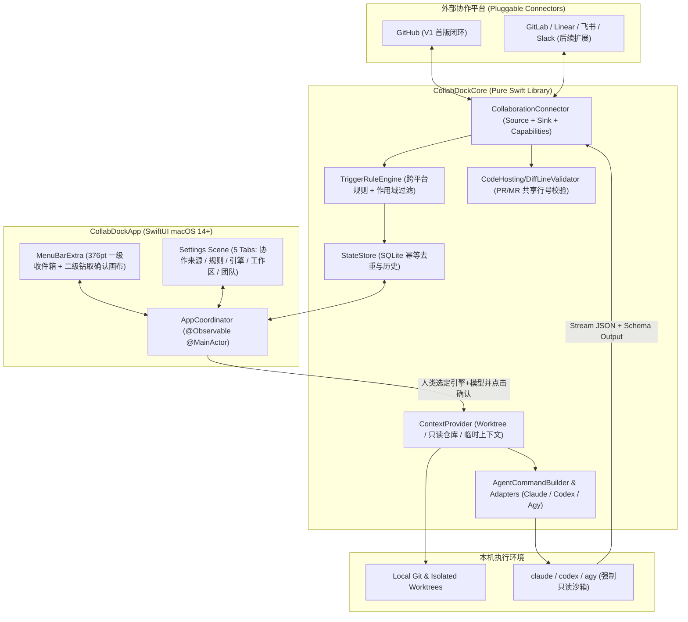

# 03 · 系统技术架构设计（Architecture）

> **2026-11-28 起执行方式只保留 Lody（见 [ADR-008](decisions/ADR-008-lody-only-execution.md)）。** 文中关于直连 Claude Code / Codex / Antigravity CLI、托管运行、JSON Schema、双模型会诊、GitHub Pending 草稿回写和本地报告的内容已过时，仅作历史参考。

> **关联决策**：[ADR-001](./decisions/ADR-001-native-swiftui-menubar.md) | [ADR-002](./decisions/ADR-002-github-conditional-polling.md) | [ADR-003](./decisions/ADR-003-unified-cli-adapter-and-sandbox.md) | [ADR-004](./decisions/ADR-004-pending-review-and-distribution.md) | [ADR-005](./decisions/ADR-005-generalize-to-collabdock.md) | [ADR-006](./decisions/ADR-006-native-session-and-background-drivers.md) | [ADR-007](./decisions/ADR-007-lody-integration.md)

---

## 1. 架构总览：四柱可插拔本地 AI 协作管线

CollabDock 采用**纯 Swift 双 Target 分层架构（`CollabDockCore` + `CollabDockApp`）**，将外部协作平台与本地 AI 执行彻底解耦为四个可插拔支柱：

1. **Collaboration Connector（`CollaborationSource` + `CollaborationSink`）**：屏蔽平台差异（V1 完整实现 GitHub Connector，后续可热插拔扩展 GitLab / 飞书 / Slack / Linear / Webhook）。
2. **Trigger Rule Engine**：跨平台统一规则过滤（全局默认 + 按连接器覆写，`@mention` 关键词、指派开关、通用作用域白/黑名单与防自循环）。
3. **Context Provider**：按载荷类型按需准备本地隔离上下文（`.codeChange` -> 隔离 `git worktree`；`.issueTicket` / `.conversation` -> 关联本地只读仓库或临时只读上下文目录）。
4. **Unified Agent Adapter**：统一封装 `claude` / `codex` / `agy` 只读沙箱无头调用、流式进度与双模态 JSON Schema 输出（`CodeReviewResult` / `StructuredReplyResult`）。



---

## 2. 模块职责与代码目录映射

```text
collabdock/
├── Package.swift                                        # SwiftPM 配置（macOS 14+，Swift 6）
├── Makefile                                             # build / test / app / run / clean
├── scripts/package-app.sh                               # 组装签名原生 CollabDock.app
├── Resources/Info.plist                                 # dev.collabdock.app, LSUIElement = true
├── Sources/
│   ├── CollabDockCore/                                  # 核心业务库（零 SwiftUI 依赖，可完整单测）
│   │   ├── Models/CollaborationModels.swift             # PlatformKind, CollaborationItem, CollaborationPayload, ExecutionOutput
│   │   ├── Connectors/
│   │   │   ├── CollaborationConnector.swift             # Source/Sink/Connector 协议与 ConnectorCatalog
│   │   │   ├── CodeHosting/DiffLineValidator.swift      # GitHub/GitLab 共享 Diff 行号校验
│   │   │   └── GitHub/                                  # [M1/M3] GitHubConnector 实现
│   │   ├── Config/AppSettings.swift                     # 多连接器配置、TriggerRules、多场景 TaskPreset、TeamPreset
│   │   ├── Rules/TriggerRuleEngine.swift                # 跨平台统一规则引擎
│   │   ├── Agents/                                      # AgentCommandBuilder, [M1] EnvironmentDetector, [M3] CLI Runners
│   │   ├── Workspace/                                   # [M3] ContextProvider & WorktreeManager
│   │   └── Storage/                                     # [M1] SQLiteTaskStore
│   └── CollabDockApp/                                   # 原生 SwiftUI 菜单栏应用
│       ├── CollabDockApp.swift                          # @main 入口（MenuBarExtra + Settings）
│       ├── AppCoordinator.swift                         # 状态协调器与多平台过滤
│       ├── Theme/DesignSystem.swift                     # CodexBar × Magpie × Linear 视觉组件库
│       ├── Views/                                       # MenuBarContentView, TaskDetailView, SettingsView
│       └── Debug/PreviewSnapshotter.swift               # DEBUG 离屏 Light/Dark 视觉回归工具
└── Tests/CollabDockCoreTests/                           # 跨平台规则、三端命令沙箱、Diff 校验与连接器能力单测
```

---

## 3. 关键工程与安全契约

### 3.1 双模态结构化输出 Schema
- **代码变更载荷（`.codeChange`）**：约束输出 `CodeReviewResult`（`summary`、`recommendedVerdict`、`comments[]` 含行号与 `suggestion`），经 `DiffLineValidator` 校验后由代码托管 Sink 提交为 Pending Review 草稿。
- **工单/群聊载荷（`.issueTicket` / `.conversation`）**：约束输出 `StructuredReplyResult`（`summary`、`replyMarkdown`、`keyPoints`、`referencedFiles`），默认沉淀为本地可编辑/可一键复制的回复草稿。

### 3.2 三层安全防线（跨平台统一强制）
1. **人工确认门控**：任何外部来源事件均不自动启动本地 AI，必须在菜单栏二级确认页由人眼查看原文并显式点击执行。
2. **只读沙箱与输入边界隔离**：强制注入三家 CLI 只读沙箱参数，所有外部标题、评论、群聊消息统一包裹在 `<untrusted_external_data>` 内。
3. **写权限隔离**：AI 子进程不接触任何外部平台写 Token，外部回写一律由宿主 `CollaborationSink` 完成。
